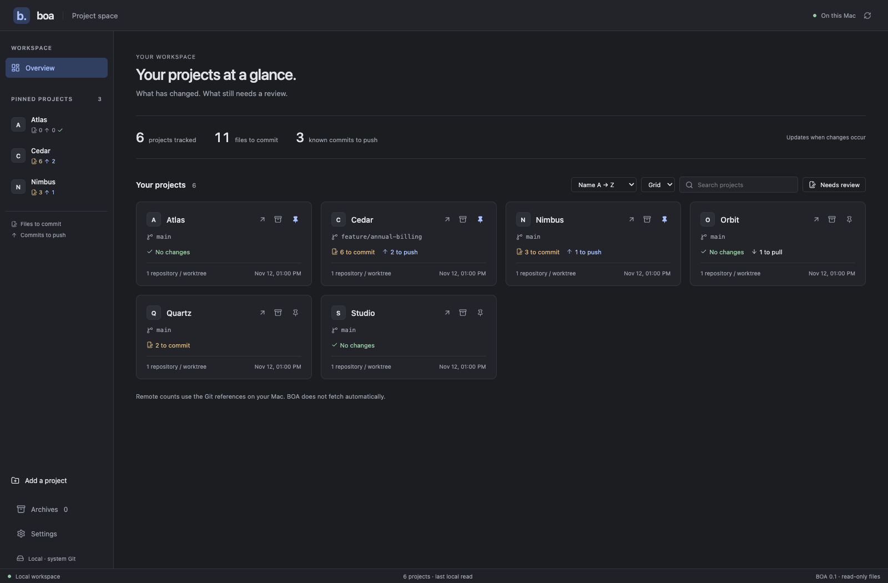
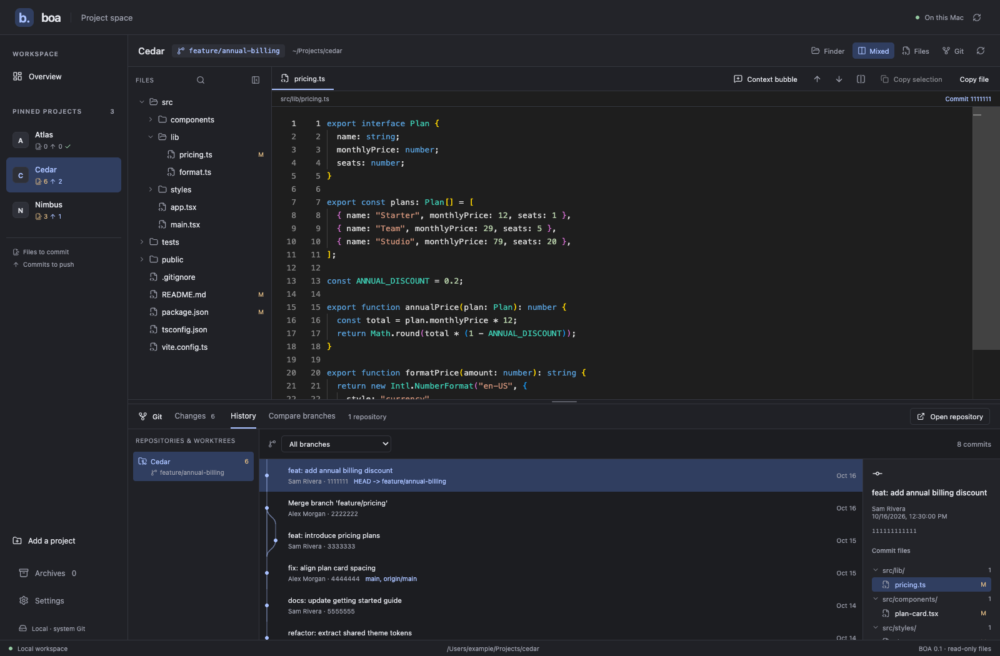

<p align="center"></p>
<h1 align="center">BOA</h1>
<p align="center">A local macOS cockpit for your projects, files and Git changes.</p>
<p align="center"><a href="https://github.com/julien-m/boa/actions/workflows/quality.yaml"></a> <a href="LICENSE">MIT license</a></p>





BOA helps you see which projects need attention and understand what changed without opening a full IDE. It combines a project dashboard, a file viewer with an explicit editing mode and Git review panes inspired by WebStorm. The interface supports French (default) and English, selectable in Settings.

**A fresh installation starts empty.** BOA does not discover your home folder, import someone else's projects or scan any directory before you choose one. Previously added projects stay on your own Mac.

These screenshots show BOA's actual interface with fictional projects, paths, code and commits. No personal workspace data is included. To regenerate them, start `bun run dev`, then run `bun scripts/capture-demo.ts` with Chrome installed. The capture script supplies in-memory demo data and does not connect to the native app or read its preferences.

## What you can do

- Add folders explicitly, pin projects and sort the dashboard by name, activity or changed files.
- Distinguish files to commit from commits to push; a `?` means the branch has no upstream.
- Controls offer translated hints on hover and keyboard focus, following the selected interface language. File and folder selection remains visible after focus leaves the tree; revealing a library file also selects it.
- Browse files, nested repositories and Git worktrees. Read code with local syntax highlighting, including JavaScript ES modules (`.mjs`), JSON/JSONC, YAML, XML/SVG and TOML/Wrangler configurations.
- Open Markdown documents (`.md` and `.markdown`, case-insensitive) in preview by default, including CLI line targets, or explicitly switch to Source/editing. Preview Markdown documents with local PNG, JPEG, GIF, WebP and SVG images, or switch to their source. Local image paths resolve relative to the document, stay within the registered project and are limited to 8 MiB each. HTTP(S) images and badges load directly from their URLs when previewing a document, without sending a referrer. Sanitized HTML supports embedded `` tags and their dimensions; scripts and active HTML are removed. Failed images fall back to their descriptions.
- Select PNG, JPEG, GIF, WebP or SVG files in a project or file-space tree to preview the image (8 MiB maximum). SVG retains an explicit Source/editing view within the 2 MiB text limit. Unsupported files, including videos, show a clear fallback with **Open with macOS**; opening occurs only after clicking the button and uses the associated application. Corrupt or oversized images offer the same fallback. Unknown extensions containing valid UTF-8 text retain the text reader. Image previews and individually expanded Markdown images/diagram images share a discreet zoom bar: −/+, a 25–1600% slider, click the percentage for intrinsic 100% size, or **Fit** to adapt to the viewport. Numeric zoom is independent of window size; Fit enlarges or reduces the image to fill the available viewport without cropping, even beyond the manual 1600% limit, and updates when the viewport changes. In the library viewer, moving to another image retains the chosen zoom, including the precise percentage computed by Fit; click Fit again to adapt the new image. Images remain scrollable at large zoom.

Les aperçus image et les images/diagrammes Markdown agrandis individuellement partagent le zoom manuel 25–1600 %, le retour à 100 % réel et **Adapter**. Adapter agrandit ou réduit l’image pour occuper au maximum la vue, sans recadrage, y compris au-delà de 1600 % si nécessaire. Dans la visionneuse de la bibliothèque, Suivant/Précédent conservent le zoom choisi, y compris le pourcentage obtenu avec Adapter. Cliquez à nouveau sur Adapter pour ajuster la nouvelle image. Les dimensions du fichier restent inchangées.

Les infobulles suivent la langue de l’application, au survol comme au clavier. La sélection du fichier ou du dossier reste visible dans l’arbre après perte du focus ; retrouver un fichier le sélectionne également.

- Image inspection tools beside Fit provide the default background, a transparency checkerboard, white, black or a custom color, with reset. Dimensions and file size are shown; remote images without reliable size metadata report it as unavailable. The eyedropper samples an intrinsic image pixel and copies HEX (including alpha when needed), with an RGBA confirmation. Browsers may prevent pixel access for remote images; a clear message is shown. At 400% zoom and above, the optional pixel grid uses crisp pixels. Background, grid and zoom choices stay with the library browsing session. **Compare two images** opens a separate comparison view; choose a second local image up to 8 MiB with the native picker, starting in the current file’s project folder (or its project root), then compare side by side or with a wipe slider using a common scale without stretching either image. The original files stay unchanged.

- The **Library** tab lists PNG, JPEG, GIF, WebP and SVG images from the current root or a chosen folder and its subfolders. The library follows the folder selected in the tree; breadcrumbs let you return to its parents. Filter by format and filename/path: multiple words separated by spaces or `+` must all match, ignoring case and accents. Clicking a thumbnail opens an overlay preview above the grid. Previous/next buttons, Left/Right and Page Up/Down browse the filtered images; zoom, Fit and fullscreen remain available. Escape returns to the same grid. **Open in Files** explicitly opens the main reader. **Reveal in file tree** opens the containing folder and focuses the file. Switching back to the library preserves its filters and scroll position. Thumbnails load progressively; unavailable thumbnails remain openable. Discovery respects file visibility preferences, skips technical folders and links, and reports partial lists (500 images, 10,000 entries, depth 24 or 3 seconds). Raster thumbnails are bounded to 160 pixels; large/unsupported thumbnail sources fall back to an icon. The existing full-image preview limits still apply.
- The fullscreen icon beside **Fit** expands a selected image to fill the BOA window, sharing the selected zoom/Fit mode with the reader. Escape or Close returns to the reader and restores focus.

L’onglet **Bibliothèque** regroupe les images du dossier et de ses sous-dossiers. La bibliothèque suit le dossier choisi dans l’arbre ; le fil d’Ariane permet de remonter. Les filtres par format et nom/chemin acceptent plusieurs mots séparés par des espaces ou `+`, tous recherchés sans tenir compte de la casse ni des accents. Un clic ouvre une visionneuse sur fond assombri au-dessus de la grille : précédent/suivant, ←/→ et Page précédente/suivante parcourent les images filtrées, avec zoom, Adapter et plein écran. Échap revient à la grille. **Ouvrir dans Fichiers** reste explicite ; **Retrouver dans l’arborescence** ouvre son dossier et cible le fichier. Les filtres et le défilement restent en place au retour. Les miniatures se chargent progressivement, sans modifier les fichiers. La liste est bornée et indique si elle est partielle ; elle respecte la sélection visible et exclut les dossiers techniques et les liens. Une miniature indisponible reste ouvrable dans le lecteur. L’icône plein écran à côté d’**Adapter** partage le zoom choisi et le mode Adapter avec le lecteur ; Échap ou Fermer revient à l’aperçu précédent.
- Inspect staged/local changes, commit history and a branch's changes since its common ancestor with a base. Compare before/after and jump between changed blocks.
- Click the **Read-only** label to edit in place, preserving the editor position; save explicitly (Cmd/Ctrl+S), undo/redo, or cancel. Edits stay in the same editor. Cancel asks before discarding changes. Unsaved drafts survive tab/project navigation during the session and remain reachable from the Drafts menu. Files changed externally are not silently overwritten. Git diffs stay read-only; editing is restricted to existing UTF-8 files inside the project (2 MB maximum), excluding Git metadata and external symlink targets. On macOS, atomic saves retain extended attributes, ACLs, owner/group and permissions; an inability to preserve metadata aborts the save.
- Use Files, Git or a combined layout; resize the file tree and Git panels, and hide the file tree. Collapsing the tree keeps expanded folders and the reader mounted, with a short transition (disabled when reduced motion is requested). Single-click a file for a temporary preview; double-click to keep it in a tab. Switch between open tabs or close them individually. Retained source tabs preserve their cursor, scroll position and undo history; editing keeps a preview tab open.
- Search in a file or across a selected project.
- Open the selected repository in your browser (HTTP(S) and common SSH remotes), or open the project folder in Finder. The web button prefers `origin`, then the first supported remote; it is disabled when none is available. Credentials, query strings and fragments are removed from browser URLs.
- Prepare a small AI context: selected text plus your comment, or just the file path plus your comment. Copy it to an assistant of your choice. No conversation history, model backend or automatic AI submission.
- Let a CLI or coding agent add/pin projects and open a file at exact lines.

Source files can be edited only after explicitly switching out of Read-only mode. Git views do not stage changes, commit, push or check out branches. Remote counters use existing local tracking references; BOA does not run `git fetch` automatically.

## Settings and archives

Open **Réglages / Settings** from the sidebar to optionally select your main projects folder. Its visible direct child directories, including folders without Git, are added at startup and on native filesystem notifications while BOA is open. Symlink aliases are deduplicated by canonical path; pins and existing projects are preserved. No folder is selected by default. Changing or disabling discovery stops additions from the old location and keeps projects already registered. An inaccessible watched folder shows a warning without hiding existing projects.

Use a project's **Archive** button to move it out of the overview and pinned navigation. **Archives** lists those projects and lets you restore them. Automatic discovery keeps them archived; explicitly adding the same project again restores it. Archiving only changes BOA's local list: it never moves, deletes or edits the project folder. Archived projects have no background Git monitoring; restoring one starts a fresh Git scan. Active projects refresh their status on relevant native file notifications, coalesced over 750 ms and limited to one refresh batch every three seconds during continuous writes. A bounded mailbox keeps one pending notification per affected project instead of retaining every filesystem event; Git object/log/lock traffic and common build/dependency caches are filtered. Open files update on these events. The code viewer and Markdown preview try to keep the same visible passage using a text anchor when content is inserted above it; when that passage disappears, the viewer keeps a nearby position. An active editing draft is preserved and external changes are reported. There are no periodic project or Git scans. Returning to BOA does not rescan all projects. Use Refresh to reconcile missed notifications manually. Discovery reacts only to changes of direct child directories. Filesystems that do not support native notifications can be refreshed manually; monitoring errors appear in Settings.

Choose **Français** or **English** in Settings to switch immediately. The preference is stored locally; translations and plural rules use i18next/react-i18next with bundled catalogues in [src/locales](src/locales). To add a language, provide matching namespace keys and interpolation parameters, extend the supported language codes and update the language selector and native preference validation.

## Install from source

BOA currently targets **macOS**. CI builds and tests macOS 15 on Apple Silicon and Intel. Windows is not supported by the current Unix CLI implementation; Linux is not a supported desktop target yet.

Requirements:

| Tool | Used for |
| --- | --- |
| Xcode Command Line Tools | Native compiler/SDK and system Git; install with `xcode-select --install` |
| Rust 1.94+ with Cargo | Desktop backend; install through [rustup](https://rustup.rs/) |
| Bun 1.3.9+ | Frontend, build commands and optional CLI; see [Bun installation](https://bun.sh/docs/installation) |
| ripgrep | Project-wide search; with Homebrew: `brew install ripgrep` |

The packaged app does not need Bun or Rust at runtime. It does use system Git, and project search requires ripgrep. BOA checks `PATH` and the usual Apple Silicon/Intel Homebrew locations for ripgrep.

```bash
git clone https://github.com/julien-m/boa.git
cd boa
bun install --frozen-lockfile
```

### Stable local signing and updates

macOS privacy permissions are associated with an application's signing identity. An ad-hoc signature changes with the code and can cause Documents access to be requested again after updates. Use the same valid Keychain signing identity and the same bundle identifier for installed updates. See [Apple's signing requirements](https://developer.apple.com/documentation/technotes/tn3127-inside-code-signing-requirements).

List the available identities, then replace `CERTIFICATE_SHA1` below with the exact fingerprint of your existing Apple Development or Developer ID Application certificate:

```bash
security find-identity -v -p codesigning
bun run mac:signing -- CERTIFICATE_SHA1
bun run mac:build
bun run mac:install
```

The shared local profile stores only the certificate fingerprint in `~/Library/Application Support/local-app-signing/identity.json`, outside the repository. The private key stays in Keychain. This identity can be reused for other locally built apps; each must retain its own bundle identifier and permissions. Missing/expired certificates fail explicitly instead of falling back to ad-hoc signing. Unlock your login Keychain if macOS refuses access to the signing key. Do not change Keychain access controls or export a private key to make a build pass.

The bundle is generated at `src-tauri/target/release/bundle/macos/BOA.app`. Quit BOA before updating, preserving unsaved edits. `mac:install` signs a staged copy, verifies the bundle, checks that an existing certificate signature's designated requirement remains mutually compatible, then replaces `~/Applications/BOA.app`. It preserves user settings and moves the previous bundle to Trash. If a legacy copy exists at `/Applications/BOA.app`, installation stops before changing either app: quit BOA, use Finder to move that copy to `~/Applications/BOA.app` (keep a backup if both locations already exist), remove the duplicate from `/Applications`, and update Dock shortcuts before retrying. Incompatible signers are rejected before replacement. Switching from an ad-hoc build to a stable certificate may require one final authorization. At certificate renewal, configure the renewed identity and keep the same signing class/team; incompatible requirements remain blocked.

To install an extracted CI artifact with your local identity, use `bun run mac:install -- /path/to/BOA.app`. Avoid overwriting the installed app directly with an ad-hoc CI build: that discards the stable identity. For disposable unsigned-identity development artifacts only, use `bun run mac:build -- --adhoc`; CI explicitly uses that mode and never receives your private key. Ad-hoc artifacts are not accepted by the installer without re-signing.

There is no Developer ID-signed, notarized public installer yet. Local Apple Development signing is not public distribution or notarization. See [Tauri's macOS prerequisites](https://tauri.app/start/prerequisites/#macos) for environment setup. Open BOA after installation and click **Ajouter un dossier** to choose your first project. Adding a folder does not pin it automatically; use its pin button if you want it in the sidebar.

For local development:

```bash
bun run tauri dev
```

## CLI and coding agents

Install/open BOA.app first. From the source checkout, install the optional command:

```bash
bun link
boa --help
```

Or run `bun scripts/boa.ts ...` without a global link.

```bash
boa projects list --json
boa projects add "$HOME/Projects/my-app" --pin --json
boa projects pin "$HOME/Projects/my-app" --json
boa projects unpin "$HOME/Projects/my-app" --json
boa projects favorite "$HOME/Projects/my-app" --json
boa open "$HOME/Projects/my-app/src/main.ts" --line 12 --end-line 24 --source Codex
```

`favorite`/`unfavorite` are aliases for `pin`/`unpin`: there is one preference, not two competing lists. Short forms such as `boa add <folder>` and `boa pin <folder>` are also available. Use `--dry-run` on navigation or mutation commands to inspect a request without applying it.

Project commands return `{ "ok": true, "result": ... }` with `--json`; failures return `{ "ok": false, "error": ... }` and a nonzero exit code. They launch the installed app if needed and communicate through a per-user Unix socket with owner-only permissions, bounded messages and timeouts. The app owns configuration updates and immediately refreshes its view. The CLI never edits the preferences file behind the app's back.

`open` uses the `boa://open` URL scheme. Its source label can be Codex, Claude, Cursor or CLI; it records a declared sender, not an authenticated AI session. **Reprendre la main** suspends incoming navigation. The file must belong to a registered project or a registered file-space folder. An exit code of zero from `open` confirms that macOS accepted the URL, not that BOA has finished rendering or scrolled; `open` has no display acknowledgement. A paused guidance session ignores incoming navigation, and there is currently no CLI command to resume it.

Markdown tables use the browser’s intrinsic content widths, with no fixed column sizes. A separate, keyboard-focusable horizontal scroll container keeps wide tables accessible. Hover or focus a table, fenced code/diagram block or image to reveal **Expand**. The block opens in a modal filling the BOA window; Escape or Close returns to the same reading position, including table scrolling. The **Expand** action above the preview opens the whole Markdown document with the full available width. Diagram fences retain their existing code rendering.

Les tableaux, blocs de code/diagrammes et images proposent **Agrandir** au survol ou au clavier ; **Agrandir** en haut de l’aperçu ouvre tout le Markdown. Échap ou Fermer revient à la lecture sans perdre sa position. Les diagrammes en blocs de code gardent leur rendu existant.

Markdown line ranges stay in the rendered preview: BOA reveals the first matching block and persistently highlights the smallest matching blocks, including individual table rows. A new request replaces the highlight and scrolls again, even for the same range. Blank lines or syntax with no rendered element (such as a table separator) target the containing or nearest visible block; a range beyond the end targets the last visible block. Source, explicit editing, Find and Git diffs remain available. Existing editing drafts stay in editing mode.

```bash
boa open "$HOME/Projects/my-app/docs/schema.md" --line 120 --end-line 132 --source Codex
```

Les images PNG, JPEG, GIF, WebP et SVG sélectionnées dans l’arborescence ont un aperçu intégré, limité à 8 Mio. Les vidéos et autres fichiers non affichables proposent **Ouvrir avec macOS**, sans ouverture automatique. Une image invalide ou trop volumineuse propose aussi ce recours. Le SVG conserve son accès explicite au source dans la limite de lecture texte.

Les Markdown s’ouvrent en aperçu par défaut, par clic comme par CLI. `--line` et `--end-line` révèlent et mettent en évidence les blocs rendus correspondants, y compris les lignes d’un tableau. Une nouvelle demande remplace le surlignage. Une ligne sans élément rendu vise le bloc contenant ou le plus proche. Source et édition restent accessibles ; un brouillon actif reste en édition. Le code retour de `open` confirme l’envoi à macOS, sans accusé d’affichage de BOA. **Reprendre la main** suspend les demandes ; aucune commande CLI ne réactive ce suivi.

Read [the BOA agent skill](.agent-sync.local/skills/boa/SKILL.md) for the complete CLI reference and voice-demo navigation context. Its source lives in this repository. With cc-hub installed, provider links can be generated from a **stable checkout** using:

```bash
cc-hub skill link ./.agent-sync.local/skills/boa --agent-sync-root ./.agent-sync.local --scope global --targets all --json
cc-hub skill status --agent-sync-root ./.agent-sync.local --scope global --targets all --name boa --json
```

The custom root keeps `.agent-sync.local/skills/boa` canonical in BOA and lets cc-hub manage provider links. Do not run these commands from a temporary worktree whose deletion would break the links. The BOA skill documents the CLI; it does not install or update BOA.app. Read [the CLI latency study](docs/cli-latency.md) for measured request-preparation cost, unmeasured display latency and the CLI/MCP comparison plan.

**Add to a file space…** in the tree context menu creates a space with the selected item’s name and path already filled in, or appends the item to an existing space. Creation needs no manual input; the proposed name remains editable. A single file stays an isolated entry, with no sibling files added. Existing entries are preserved and duplicate paths are ignored.

**Ajouter à un espace de fichiers…** au clic droit propose un nouvel espace prérempli avec le nom et le chemin de l’élément, ou l’ajout à un espace existant. Il suffit de valider ; le nom proposé reste modifiable. Un fichier reste une entrée individuelle ; ses voisins ne sont pas ajoutés. Les autres entrées sont conservées et les doublons évités.

Right-click a file, folder or pinned item for BOA actions: reveal in Finder, open, keep the tab, copy its name/path, pin, or prepare a context message. Image actions include fullscreen and comparison; folder actions include its image library and search. The menu also opens with Shift+F10 and follows the selected application language. These actions do not rename, move or delete files.

Un clic droit sur un fichier, dossier ou favori ouvre le menu BOA : retrouver dans Finder, ouvrir, conserver l’onglet, copier le nom/chemin, épingler ou préparer un message de contexte. Les images proposent le plein écran et la comparaison ; les dossiers proposent leur bibliothèque et leur recherche. Le menu est aussi accessible avec Maj+F10 et suit la langue de l’application.

Markdown links to local files open in BOA, relative to the current document. Heading anchors work within a document and across linked files; repeated heading titles get distinct anchors. Navigation preserves active drafts. Files outside the current root must belong to another registered project or space; following a link restores an archived target project before opening its file. External URLs keep the existing copy-link behavior.

Les liens Markdown vers des fichiers locaux s’ouvrent dans BOA, relativement au document courant. Les ancres fonctionnent dans le même document et dans un autre fichier ; les titres répétés ont des ancres distinctes. Les brouillons sont conservés. Un fichier hors du dossier courant doit appartenir à un autre projet ou espace enregistré ; un projet cible archivé est restauré avant l’ouverture du fichier.

Right-click a Library thumbnail or its enlarged preview (or press Shift+F10) to reveal that image in Finder without leaving the gallery. Le clic droit sur une vignette ou l’aperçu agrandi de la Bibliothèque propose **Afficher dans Finder**, aussi accessible avec Maj+F10.

The Library offers **Load all** alongside batches of 48 images. It displays all images returned by the bounded scan, including newly returned images after refresh; thumbnails remain lazy. Changing folder, name filter or image type resets the batch size. La Bibliothèque propose **Tout charger** en plus des lots de 48 images, tout en conservant les limites du scan et le chargement progressif des miniatures.

## File spaces and focused browsing

Use **Settings → File spaces** to create a named collection of existing folders and individual files. Spaces appear separately in the sidebar and never run Git discovery or status scans. Files stay in their original locations. Each folder has an on-demand visibility/sort menu: choose the files and subfolders to show, temporarily show everything, or sort by name or modification date (newest or oldest first). Selecting a folder includes its descendants; ancestors remain traversable. Pinned files and folders stay accessible even when excluded from the visible selection. Pins stay above the tree and can be reordered by drag-and-drop or the arrow buttons. Visibility and pins are local preferences, not access-control boundaries. Opening the item chooser does not activate the filter before a selection is made. An empty saved selection offers **Show all** directly in the tree; this recovery is saved. Le tri chronologique propose les deux sens, du plus récent au plus ancien et inversement. Le choix des éléments visibles n’active le filtre qu’à la première sélection.

```bash
boa spaces save ai-tools --name "AI tools" --root "$HOME/.claude" --root "$HOME/.codex"
boa spaces list --json
boa files configure "$HOME/.codex" --include skills --include AGENTS.md --pin AGENTS.md --sort modified
boa files preferences "$HOME/.codex" --json
boa spaces remove ai-tools --dry-run
```

`spaces save` creates or replaces the space with that ID; repeat `--root` for folders and `--file` for individual files. At least one is required. Paths are canonicalized and deduplicated. `--sort modified` uses newest first, and `--sort modified-asc` uses oldest first. `files configure` replaces that folder's complete visibility, pin order and sort preferences. Repeat `--include` and `--pin` as needed; `--all` disables filtering. Removing a space only removes its BOA entry, never its files. Registered space folders and individual files support `boa open` just like project folders.

Search fields stay hidden until requested. With the file tree focused, start typing to open a temporary path filter above the results; names update after a short pause without pressing Enter. Escape in an empty filter or Close restores the same tree. The collapsed tree keeps a dedicated, always-accessible reopen button. Cmd/Ctrl+F searches names under the focused file tree, or text in the current file when the editor has focus. Cmd/Ctrl+Shift+F opens a temporary global panel for names, contents or both across active projects and file spaces. Enter starts the global search. Search fields show a clear button while nonempty; Escape clears the focused field and its results, keeping focus. A second Escape closes contextual/global panels, as does clicking the global overlay background. Change both shortcuts in Settings. Global/tree search observes explicit folder selections, skips Git metadata and common dependency/cache directories, does not traverse symlinks, and is bounded to 10 seconds, 10,000 visited entries, 32 nested levels, 300 results and 2 MiB per text file. It does not create a background index.

Dans Files, cliquez dans l’arborescence puis tapez pour afficher le filtre de noms, sans bouton Rechercher ni validation par Entrée. Échap ou Fermer retrouve l’arborescence. Le bouton de réouverture reste visible quand le panneau est replié. La recherche globale de noms/contenu conserve son raccourci.

For maintenance instructions, read [AGENTS.md](AGENTS.md) and [CLAUDE.md](CLAUDE.md). Remove obsolete temporary/build outputs after validation while retaining needed deliverables and recovery data.

## Keyboard shortcuts

| Shortcut | Action |
| --- | --- |
| `⌘F` / `Ctrl+F` | Find in the file; Markdown switches to Source |
| `⌘⇧F` / `Ctrl+⇧F` | Search names and contents across projects and spaces |
| `⌘⇧B` / `Ctrl+⇧B` | Open the context dialog |
| `Enter` / `Shift+Enter` in the dialog | Copy context / insert a newline |
| `Escape` or a click outside the dialog | Close the dialog |
| Arrow keys on a panel separator | Resize the corresponding panel |

## Local data and privacy

- The project list is stored in the current user's application-data directory, in `com.julienm.boa/projects.json` (on macOS: `~/Library/Application Support/com.julienm.boa/projects.json`). Layout preferences stay in the app's local webview storage. Neither is bundled with the app or committed to this repository.
- An empty first launch performs no project scan. BOA reads registered projects and an optional explicitly configured discovery folder. Imported configuration from an earlier BOA version remains intact.
- A selected project can contain nested repositories and external Git worktrees. Explicit symbolic links in its file tree can lead outside the project; BOA follows these when you browse them. File contents remain on the Mac until you explicitly copy and share them.
- BOA has no telemetry, hosted project service, embedded AI provider or credential configuration. It runs system Git with argument arrays rather than a shell. Browsing and Git review do not modify the selected repositories.
- The macOS bundle permits HTTP loads in its webview so cleartext image URLs also work. The content security policy allows these remote loads only for images; remote scripts and other remote connections remain blocked.
- The current context dialog stores no history and creates no export files. Older prototypes may have left exports in the local application-data directory; those are not distributed.

## Limits

Text preview supports UTF-8 files up to 2 MiB. Repository discovery inside an explicitly selected project is bounded to 6 levels / 4,000 directories, with dependency/cache directories excluded. History loads 100 commits per page. Project search is literal, respects ignore files, does not follow symbolic links and is limited to 300 results, 20 matches per file and 10 seconds. Bounds and errors are shown in the interface.

Unreadable descendants are skipped during discovery and the scan is marked partial; an unreadable project root still reports an error. Merge commit file lists and previews both compare against the first parent. During a Git conflict, both change sections show our index version (empty when deleted on our side) against the current working file, including any conflict markers.

## Quality and contributions

```bash
bun run check:public
bun run verify
cargo fmt --manifest-path src-tauri/Cargo.toml -- --check
cargo test --locked --manifest-path src-tauri/Cargo.toml
cargo clippy --locked --manifest-path src-tauri/Cargo.toml --all-targets -- -D warnings
```

For browser UI contracts, start `bun run dev` in another terminal, then run:

```bash
bun run test:ui
```

The UI test uses Chrome by default. For a clean environment, run `bunx playwright install chromium` and `BOA_TEST_BROWSER=chromium bun run test:ui`. It uses a mocked Tauri transport with the real Monaco viewer; native Rust tests exercise real disposable Git repositories, configuration and Unix sockets. No ordinary test needs personal projects, credentials or a GitHub account.

The optional ignored live smoke test reads only a folder you explicitly provide through `BOA_SMOKE_PROJECT`. Do not use personal folders to reproduce a bug when a disposable repository is sufficient.

Read [CONTRIBUTING.md](CONTRIBUTING.md) before submitting changes and [SECURITY.md](SECURITY.md) for reporting a vulnerability. CI runs locked installs, frontend checks/tests, Rust format/tests/Clippy, browser contracts and desktop builds on both Mac architectures. Passing CI is build/test evidence, not proof of notarization or exhaustive native UI certification.

## License

BOA is available under the [MIT License](LICENSE).
